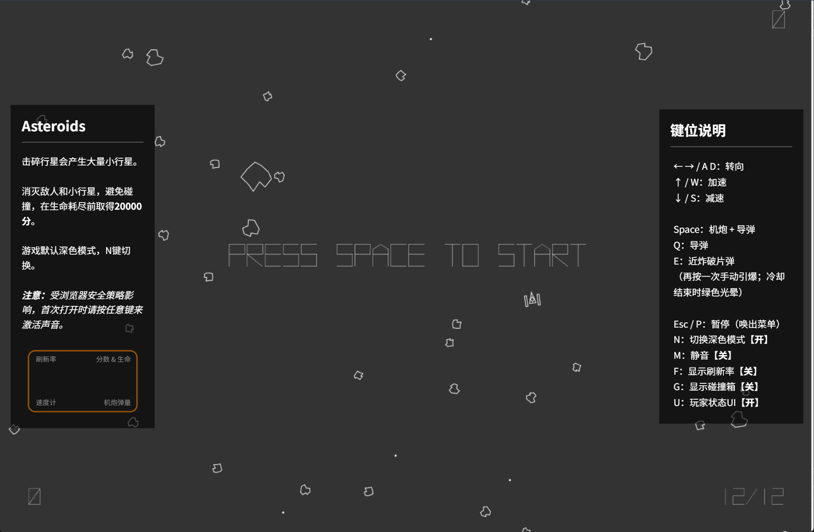
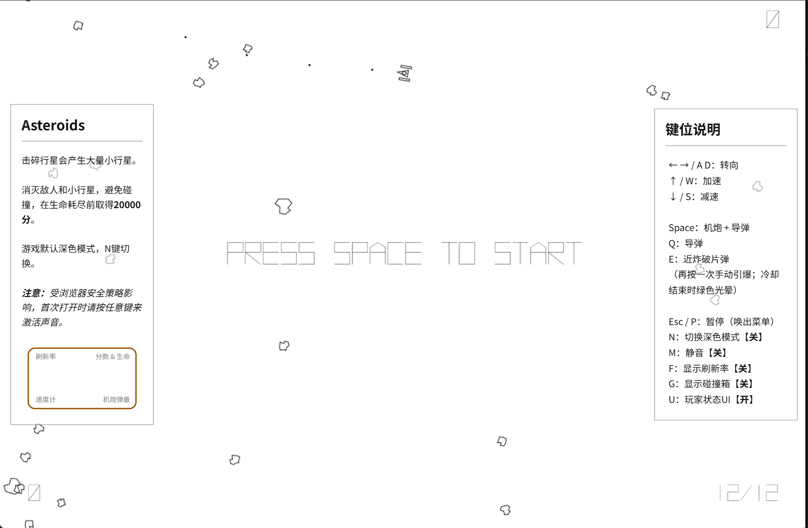
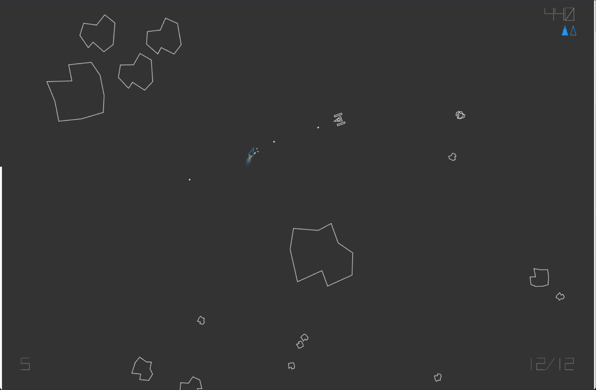

# Asteroids

中文 | [English](README_en.md)

一款使用原生 JavaScript 和 HTML5 Canvas 编写的街机太空射击游戏。驾驶飞船击碎小行星、躲避敌机，在矢量线条与彩色辉光中争取更高分数。

## 项目概览

| 1. 深色首页 | 2. 浅色首页 | 3. 游戏画面 |
| :---: | :---: | :---: |
|  |  |  |

## 特性

- 矢量风格画面，支持深色与浅色模式，画布随浏览器窗口调整大小。
- 飞船推进、惯性漂移、刹车与屏幕边缘穿越。
- 随温度变化的飞船推进尾焰。
- 机炮、追踪导弹和可手动引爆的近炸破片弹（Prox）。
- 会分裂的小行星、UFO 与敌方战机，以及逐波增加的小行星数量。
- 背景音乐、射击与爆炸音效，支持暂停和静音。
- 分数、生命、速度和弹量 HUD，以及帧率与碰撞调试显示。

## 快速开始

下载或克隆仓库后，直接用桌面浏览器打开 [`index.html`](index.html) 即可游玩，无需安装依赖或构建。

也可以在项目根目录使用 Python 3 启动本地静态服务器：

```sh
python -m http.server 8000 --bind 127.0.0.1
```

打开 <http://127.0.0.1:8000>，按 **Space** 开始游戏。首次打开时需要交互才能播放声音，如果没有声音请再按一次射击键，并检查是否已静音。

建议使用带键盘的桌面设备及现代浏览器。当前操作方式为键盘控制，未提供触屏按键。

## 玩法与操作

击碎大块小行星会产生更多碎片。消灭小行星和敌人可以得分，清空小行星后会生成下一波。初始拥有 3 套备用零件（HP），每份分为 4 格。

以超过 **20,000 分**为目标。生命耗尽后结算，得分超过该值时显示 `GOOD GAME`，否则显示 `GAME OVER`；约 8 秒后回到标题画面。

| 按键 | 功能 |
| --- | --- |
| `Space` | 标题画面开始游戏；游戏中发射机炮与导弹 |
| `←` / `A`、`→` / `D` | 左转、右转 |
| `↑` / `W` | 推进加速 |
| `↓` / `S` | 刹车减速 |
| `Q` | 发射导弹 |
| `E` | 发射近炸破片弹；再次按下可手动引爆，冷却完成时闪烁绿色辉光 |
| `Esc` / `P` | 暂停或继续，暂停时显示说明面板 |
| `N` | 切换深色 / 浅色模式（默认深色） |
| `M` | 切换静音 |
| `F` | 切换帧率显示 |
| 按住 `G` | 显示碰撞分区调试信息 |
| `U` | 切换分数、生命、速度与弹量 HUD |

## 项目结构

```text
.
├── index.html       # 页面入口与操作说明
├── styles.css       # 布局、主题与面板样式
├── game.js          # 游戏配置、实体、碰撞、音频与主循环
├── assets/
│   ├── audio/       # 背景音乐与音效
│   └── vector-battle-regular.typeface.js
├── docs/assets/     # README 截图
├── LICENSE          # MIT 许可证
├── README.md        # 中文说明
└── README_en.md     # English documentation
```

## 开发与部署

游戏使用 Canvas 2D、自定义精灵系统和空间网格碰撞分区，不依赖前端框架、包管理器或外部 CDN。

- 调整手感与难度：修改 [`game.js`](game.js) 顶部的 `GameConfig`，包括速度、武器冷却、敌机生成和生命值。
- 修改键位：编辑同一文件中的 `KEY_CODES`，并同步更新 [`index.html`](index.html) 与两份 README。
- 修改页面布局与主题：编辑 [`styles.css`](styles.css)。

部署时，将 `index.html`、`styles.css`、`game.js` 和完整 `assets/` 目录放到任意静态托管服务，保留相对路径即可。运行时无需后端或环境变量。

## 许可证与素材

项目原创代码采用 [MIT 许可证](LICENSE)，版权所有 © 2026 Harold Chiu。第三方素材保留其各自的权利与许可。

Vector Battle 字体文件保留了原作者 ck! / Freaky Fonts 的版权信息；字体渲染与动画兼容代码的来源注释也保留在源码中。音频位于 `assets/audio/`，仓库中暂无其来源与授权说明，发布或再分发前需核实素材授权。
