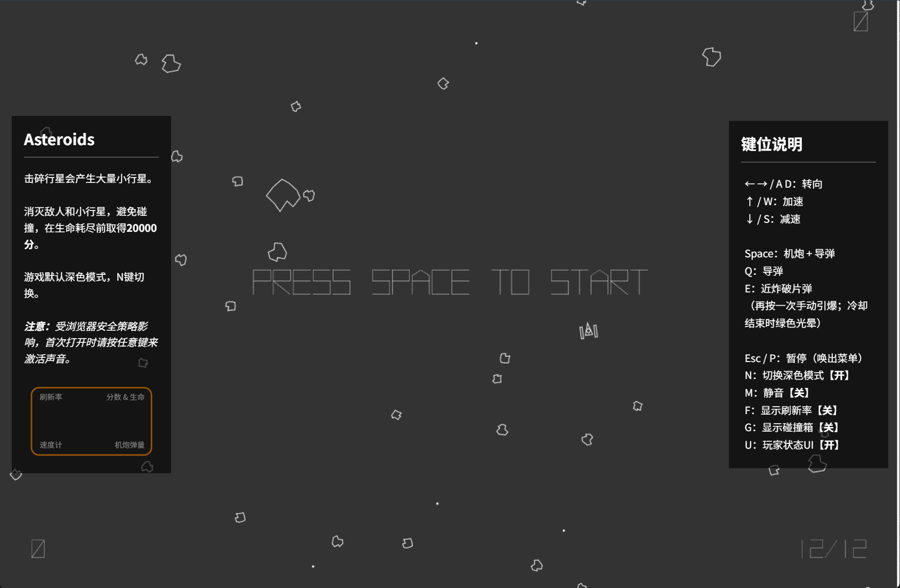
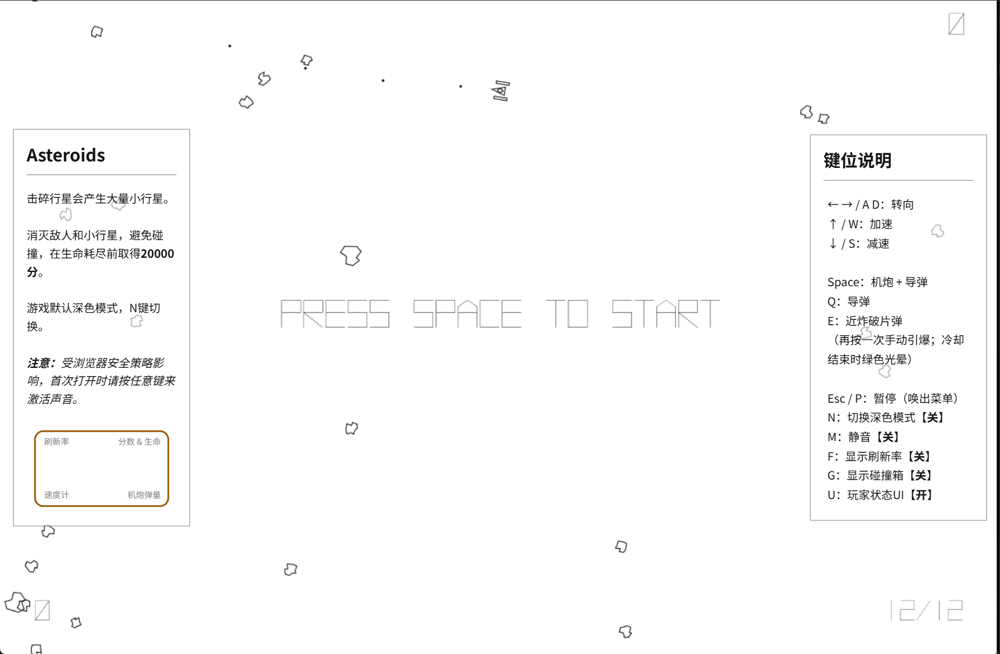
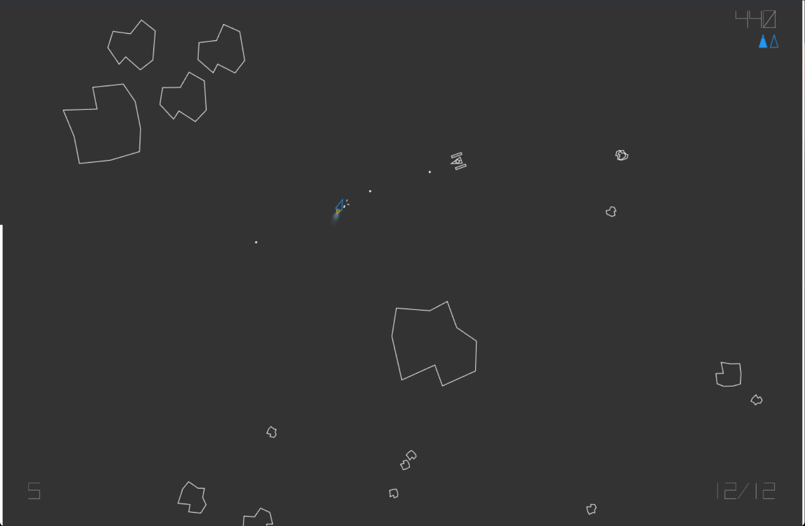

# Asteroids

[中文](README.md) | English

An arcade space shooter built with vanilla JavaScript and HTML5 Canvas. Pilot a ship, break apart asteroids, and dodge enemy fighters in a world of vector lines and colorful glow effects.

## Overview

| 1. Dark title screen | 2. Light title screen | 3. In-game view |
| :---: | :---: | :---: |
|  |  |  |

## Features

- Vector-style graphics, dark and light themes, and a canvas that fits the browser window.
- Ship thrust, inertial drifting, braking, and screen-edge wrapping.
- Ship exhaust flames that change with temperature.
- A cannon, homing missiles, and manually detonated proximity fragmentation rounds (Prox).
- Splitting asteroids, UFOs, enemy fighters, and increasing asteroid counts across waves.
- Background music, shooting and explosion effects, pause, and mute controls.
- Score, health, speed, and ammunition HUDs, plus frame-rate and collision debugging displays.

## Quick start

Download or clone the repository, then open [`index.html`](index.html) in a desktop browser. No dependencies or build step are required.

Alternatively, run a local static server from the project root with Python 3:

```sh
python -m http.server 8000 --bind 127.0.0.1
```

Open <http://127.0.0.1:8000> and press **Space** to start. Browsers require interaction before playing audio. If there is no sound, press a fire key again and check the mute setting.

A desktop device with a keyboard and a modern browser is recommended. Controls are keyboard-based; on-screen touch controls are not provided.

## Gameplay and controls

Large asteroids split into smaller pieces when destroyed. Destroy asteroids and enemies to earn points; clearing the asteroids starts the next wave. You begin with 3 sets of spare parts (HP), each divided into 4 segments.

Aim to score more than **20,000 points**. The game ends when HP is depleted: a score above that threshold displays `GOOD GAME`; otherwise it displays `GAME OVER`. The title screen returns after about 8 seconds.

| Key | Action |
| --- | --- |
| `Space` | Start from the title screen; fire the cannon and missiles during play |
| `←` / `A`, `→` / `D` | Turn left and right |
| `↑` / `W` | Thrust |
| `↓` / `S` | Brake |
| `Q` | Fire a missile |
| `E` | Launch a Prox round; press again to detonate manually. A flashing green glow signals that the cooldown has ended |
| `Esc` / `P` | Pause or resume; instruction panels appear while paused |
| `N` | Switch between dark and light themes (dark by default) |
| `M` | Toggle mute |
| `F` | Toggle the frame-rate display |
| Hold `G` | Show collision partition debugging information |
| `U` | Toggle the score, health, speed, and ammunition HUDs |

## Project structure

```text
.
├── index.html       # Entry page and instructions
├── styles.css       # Layout, themes, and panels
├── game.js          # Configuration, entities, collisions, audio, and main loop
├── assets/
│   ├── audio/       # Background music and sound effects
│   └── vector-battle-regular.typeface.js
├── docs/assets/     # README screenshots
├── LICENSE          # MIT license
├── README.md        # Chinese documentation
└── README_en.md     # English documentation
```

## Development and deployment

The game uses Canvas 2D, a custom sprite system, and a spatial grid for collision checks. It requires no frontend framework, package manager, or external CDN.

- Tune movement and difficulty in `GameConfig` at the top of [`game.js`](game.js), including speeds, weapon cooldowns, enemy spawning, and health.
- Change controls in `KEY_CODES` in the same file, then update [`index.html`](index.html) and both README files.
- Edit [`styles.css`](styles.css) to change the page layout and themes.

To deploy, upload `index.html`, `styles.css`, `game.js`, and the complete `assets/` directory to any static hosting service, preserving their relative paths. No backend or environment variables are needed at runtime.

## License and assets

The project's original code is licensed under the [MIT License](LICENSE). Copyright © 2026 Harold Chiu. Third-party assets retain their respective rights and licenses.

The Vector Battle font file retains the copyright information of its original author, ck! / Freaky Fonts. Source comments credit the font-rendering and animation compatibility code. Audio files are stored in `assets/audio/`; the repository does not currently document their sources or licenses. Verify asset permissions before publishing or redistributing them.
